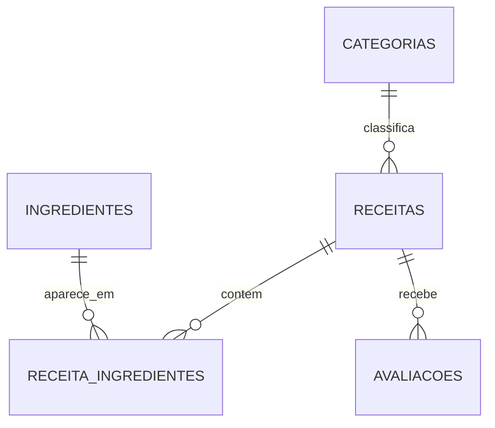

# 🍽️ Buscador Inteligente de Receitas — POO + SQLite3

Projeto da **Atividade Avaliativa 04 — Programação Orientada a Objetos** (ADS – IFSP).

**Autora:** Mirela Andressa de Oliveira
**Repositório:** https://github.com/mi-andressa/app-receitas
**Aplicação publicada:** https://app-receitas-dusky.vercel.app

## 📌 Sobre o projeto

Aplicação que reúne receitas do mundo todo **em português** e um **caderno pessoal de receitas salvo em banco SQLite3**.

- 🔎 Busca em português no TheMealDB, com tradução e medidas adaptadas ao Brasil (`tbsp` → colher de sopa, `oz`/`lb` → gramas, °F → °C).
- ♥ Favoritos gravados no banco: ao favoritar, a receita é importada já traduzida.
- 📒 **Meu caderno**: cadastrar, editar e excluir receitas com ingredientes, e avaliar com estrelas.
- 📥 Importação em lote de receitas do TheMealDB direto para o banco.
- 🖥️ Duas interfaces sobre o mesmo banco e as mesmas classes: **site** (React + FastAPI) e **terminal** (menu de opções).

## 🏗️ Arquitetura

```
Navegador (React) ─┐
                   ├─► backend/ (classes POO) ─► SQLite3 (receitas.db)
Terminal (menu) ───┘          │
                              └─► TheMealDB + Google Translate / MyMemory
```

## ▶️ Como executar

Requisitos: **Python 3.9+** e **Node.js 20.19+**.

```bash
git clone https://github.com/mi-andressa/app-receitas.git
cd app-receitas/app-receitas
python3 -m venv .venv
source .venv/bin/activate        # Windows: .venv\Scripts\activate
pip install -r requirements.txt
npm install
```

**Site** — Linux/macOS: `./dev.sh` · Windows (dois terminais):

```bash
uvicorn api.index:app --reload --port 8000   # terminal 1: API em Python
npm run dev                                  # terminal 2: interface React
```

Acesse `http://localhost:5173`. A documentação interativa da API (para testar o CRUD) fica em `http://127.0.0.1:8000/docs`.

**Terminal:**

```bash
python terminal/main.py
```

**Importar receitas do TheMealDB para o banco:**

```bash
python importar_mealdb.py
python importar_mealdb.py --por-categoria 5
python importar_mealdb.py --categorias Dessert Chicken Pasta
```

**Ver o conteúdo do banco:**

```bash
python ver_banco.py
```

**Testes automáticos:**

```bash
python -m unittest testes -v
```

O arquivo `receitas.db` é criado na raiz na primeira execução e já vem alimentado com 8 receitas de exemplo.

## 📚 Bibliotecas

| Biblioteca | Tipo | Uso |
| --- | --- | --- |
| `sqlite3` | padrão do Python | banco de dados |
| `abc`, `dataclasses`, `contextlib` | padrão do Python | classe abstrata, entidades e transações |
| `asyncio`, `re`, `json`, `pathlib`, `textwrap`, `argparse`, `unittest` | padrão do Python | requisições, conversões, scripts e testes |
| `fastapi` | pip | API REST |
| `httpx` | pip | acesso ao TheMealDB e aos tradutores |
| `uvicorn` | pip | servidor local da API |
| `react`, `vite`, `oxlint` | npm | interface web |

## 🗃️ Banco de dados (5 tabelas relacionais)



| Tabela | Descrição |
| --- | --- |
| `categorias` | Categorias (excluir deixa as receitas sem categoria — `SET NULL`) |
| `receitas` | Receitas cadastradas ou importadas do TheMealDB |
| `ingredientes` | Cadastro único de ingredientes |
| `receita_ingredientes` | Relação N:N com a quantidade (`CASCADE` / `RESTRICT`) |
| `avaliacoes` | Notas de 1 a 5 e comentários (`CASCADE`) |

Gravações de receita com seus ingredientes são feitas em **transação**: ou tudo é salvo, ou nada é salvo.

## 🔌 Endpoints do caderno (CRUD)

| Método | Rota | Ação |
| --- | --- | --- |
| GET | `/api/caderno/receitas` | Lista receitas (`?favoritas=true` filtra) |
| GET | `/api/caderno/receitas/{id}` | Detalhe com ingredientes e avaliações |
| POST | `/api/caderno/receitas` | Cria receita |
| PUT | `/api/caderno/receitas/{id}` | Atualiza receita |
| PATCH | `/api/caderno/receitas/{id}/favorita` | Favorita / desfavorita |
| DELETE | `/api/caderno/receitas/{id}` | Exclui receita |
| POST | `/api/caderno/importar` | Importa receita do TheMealDB |
| GET · POST · PUT · DELETE | `/api/caderno/categorias` | CRUD de categorias |
| GET · POST · PUT · DELETE | `/api/caderno/ingredientes` | CRUD de ingredientes |
| POST · PUT · DELETE | `/api/caderno/.../avaliacoes` | CRUD de avaliações |

Rotas de consulta ao TheMealDB: `/api/categorias`, `/api/buscar`, `/api/categoria`, `/api/receita/{id}`, `/api/aleatoria`.

## 🧱 Organização

| Pasta / arquivo | Responsabilidade |
| --- | --- |
| `backend/banco.py` | Conexão SQLite, criação das tabelas e transações |
| `backend/modelos.py` | Entidades: `Categoria`, `Receita`, `Ingrediente`, `ItemReceita`, `Avaliacao` |
| `backend/repositorios.py` | CRUD: classe abstrata `Repositorio` + 4 subclasses |
| `backend/caderno.py` | Fachada que reúne repositórios, importador e dados iniciais |
| `backend/importador.py` | Importação do TheMealDB com tradução |
| `backend/dados_iniciais.py` | Dados de exemplo carregados na primeira execução |
| `backend/mealdb.py`, `traducao.py`, `receita.py` | API externa, tradução e adaptação de medidas |
| `api/index.py` | Rotas FastAPI |
| `terminal/` | Interface de terminal (`main.py`, `menu.py`, `adaptador.py`) |
| `src/` | Interface React |
| `importar_mealdb.py` | Importação em lote de receitas para o banco |
| `ver_banco.py` | Exibe as tabelas e os registros do banco |
| `testes.py` | Testes automáticos |

## 🧠 Conceitos de POO aplicados

- **Encapsulamento:** conexão protegida em `BancoDeDados`; validações nas próprias entidades.
- **Abstração e herança:** `Repositorio` (ABC) com CRUD genérico, herdado por 4 repositórios.
- **Polimorfismo:** `ReceitaRepositorio` sobrescreve `criar()` e `buscar()` para tratar ingredientes.
- **Composição:** `Receita` contém `ItemReceita`; `Caderno` reúne os repositórios (padrão Fachada).
- **Adaptador:** `ImportadorTerminal` adapta o importador assíncrono para o terminal síncrono.
- **Exceção personalizada:** `ErroImportacao`.

## 🚀 Deploy

Publicado na Vercel (Root Directory: `app-receitas`). O banco fica em `/tmp`, que é temporário em ambiente serverless: os dados podem ser reiniciados periodicamente (voltando às receitas de exemplo). Para uso persistente, execute localmente.

> A tradução é automática e pode conter imprecisões. Se os dois serviços de tradução falharem, o texto aparece em inglês com um aviso.